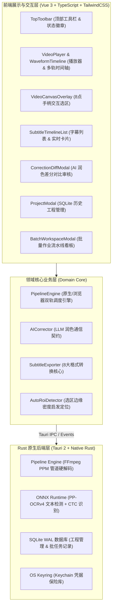

<div align="center">

# 📽️ VidGlyph · 字映

**本地优先的高性能视频硬字幕光学解析与多轨精编工坊**  
*Precision Video Hardcoded Subtitle Extraction & Optical Multitrack Studio*

[](https://github.com/Agions/VidGlyph/releases)
[](https://github.com/Agions/VidGlyph/blob/main/LICENSE)
[](https://tauri.app)
[](https://www.rust-lang.org)
[](https://vuejs.org)
[](https://www.typescriptlang.org)
[](https://github.com/Agions/VidGlyph/releases)

<p align="center">
  <a href="#-核心特性">✨ 核心特性</a> •
  <a href="#-系统架构">🏗️ 系统架构</a> •
  <a href="#-支持格式">📦 支持格式</a> •
  <a href="#-快速开始">🚀 快速开始</a> •
  <a href="#-技术栈">🛠️ 技术栈</a> •
  <a href="#-开源协议">📜 开源协议</a>
</p>

</div>

---

## 📖 简介 (Overview)

**VidGlyph（字映）** 是一款专为影视创作者、字幕翻译组、剪辑师与学术研究者打造的**本地优先、硬件加速硬编码字幕提取与精编桌面客户端**。

传统方案往往依赖前端 HTML5 `<video>` 逐帧 Seek 抽帧，卡顿耗时且易丢帧；或者通过外部脚本在磁盘写入数千张零碎 PNG 图片，导致磁盘 I/O 爆炸。

**VidGlyph 彻底重构了底层管线**：
基于 **Tauri 2 + Rust + ONNX Runtime**，利用平台级硬件解码（macOS VideoToolbox、Windows NVDEC/QSV、Linux VAAPI），通过内存匿名管道向 ONNX 模型**零临时文件输出 PPM 原始像素流**。配合智能场景跳帧与 Levenshtein 动态聚类算法，**提取吞吐量提升 20 倍以上**，毫秒级还原精准视频字幕。

---

## ✨ 核心特性 (Key Features)

### ⚡ 1. Rust 原生零拷贝流式解码流水线 (Streaming Native Pipeline)
- **硬件解码加速**：自动探测并调用系统级 GPU 硬件解码器（VideoToolbox / NVDEC / QSV）。
- **零临时磁盘文件**：FFmpeg 直接向 Rust 进程内管道吐送 PPM 纯净内存字节流，不再产生临时图片碎文件，保护固态硬盘寿命。
- **智能场景跳帧探测 (`compute_frame_diff`)**：自动比对相邻帧像素差异，静态画面直接复用时间轴，节约 80% 无效推理算力。
- **动态平滑滑动窗口聚类**：基于 Levenshtein 相似度与时间衰减算法，自动滤除视频微小抖动造成的重影时间轴毛刺。

### 🌊 2. 毫秒级音画双轨与音频波形对齐 (Multitrack Studio Timeline)
- **音频能量包络导引**：自动生成视频音轨的下采样 RMS 能量波形，直观辨识人声起止点。
- **浮动字幕块轨道**：字幕区间与波形能量并列对齐，点击任意波形位置瞬间对齐跳转播放。
- **时间轴质量自检系统**：实时扫描并高亮标注“重叠冲突”、“时间倒挂”、“空文本”等时间轴质量隐患。

### 🎯 3. 8 点交互手柄选区与 Auto-ROI 自动定位
- **8 点触控手柄**：在视频监控器上自由拖拽缩放任意比例矩形选区，百分比坐标归一化绑定。
- **一键 Auto-ROI 探测**：基于底部梯度边缘方差分析，一键自动智能识别硬字幕所在区域。
- **图像滤镜实时预览**：内置二值化、自适应高斯降噪与对比度拉伸预处理，提升复杂背景字幕识别率。

### 🤖 4. AI 智能润色与双栏差分审核视窗 (AI Proofreading & Diff Modal)
- **上下文理解润色**：结合视频文件名与多行字幕前后语境，智能修正同音别字、专业术语与语法标点。
- **红绿双栏对比审核**：原始 OCR 识别文本与 AI 修正建议清晰对照。
- **精细化采纳控制**：支持“单条切换”、“全部采纳建议”或“保留原始文本”，防止大模型幻觉污染。

### 🏭 5. 批量生产线看板 (Batch Production Pipeline)
- **多视频作业排队**：支持批量添加大量短视频或长影视切片，后台自动依次流式处理。
- **独立任务进度追踪**：任务进度条、耗时统计、实时已抽数字幕数监控，支持一键批量导出。

### 💾 6. SQLite WAL 嵌入式持久化与 `.vidglyph` 工程包
- **安全自动落盘**：嵌入式 SQLite WAL 高并发模式，随时关闭随时恢复。
- **`.vidglyph` 独立工程包**：将项目元数据、ROI 参数与字幕记录打包为独立工程文件，方便跨设备流转。

### 🔒 7. 操作系统原生安全密钥保护 (OS Keyring Vault)
- **硬件钥匙串存取**：API Key 优先存入系统密钥链（macOS Keychain / Windows Credential Manager）。
- **沙箱平滑降级**：受限沙箱或无头测试环境下，自动回退至高强度本地加密保险库。

---

## 🏗️ 系统架构设计 (Architecture)



---

## 📦 支持格式 (Supported Formats)

VidGlyph 内置全功能工业级字幕转换导出器，支持导出为以下格式：

| 格式扩展名 | 格式名称 | 适用场景 |
| :--- | :--- | :--- |
| **`.srt`** | SubRip Subtitle | 最通用的字幕标准，兼容主流播放器与 Premiere / Final Cut Pro / 剪映 |
| **`.vtt`** | WebVTT | 现代 HTML5 `<video>` 网页播放器与流媒体标准 |
| **`.ass`** | Advanced SubStation Alpha | 高级特效字幕标准，支持样式、字号、边框阴影配置 |
| **`.ssa`** | SubStation Alpha v4 | 经典动画字幕与压制标准 |
| **`.txt`** | Plain Text | 纯文本对白行，适用于文本提炼、摘要与大模型训练语料 |
| **`.csv`** | Comma-Separated Values | 表格化数据格式，便于使用 Excel、Python 进行批量分析 |
| **`.lrc`** | Lyric Sync | 音乐与播客时间戳对齐歌词文件 |
| **`.json`** | Structured JSON | 包含置信度、毫秒时间戳与语言标签的结构化开发数据 |
| **`.vidglyph`** | VidGlyph Studio Bundle | 专属工程压缩归档包，完整封存视频绑定、选区信息与全量时间轴记录 |

---

## 🚀 快速开始 (Quick Start)

### 1. 下载预编译客户端
前往 [Releases 页面](https://github.com/Agions/VidGlyph/releases) 下载适合您操作系统的最新安装包：
- **macOS**：`.dmg`（支持 Apple Silicon M 系列与 Intel x64 架构）
- **Windows**：`.msi` 或 `.exe` 安装程序
- **Linux**：`.AppImage` 或 `.deb`

### 2. 源码构建与开发

#### 环境要求：
- [Node.js](https://nodejs.org) >= 18.0.0
- [pnpm](https://pnpm.io) >= 9.0.0
- [Rust](https://rustup.rs) >= 1.77.0
- [FFmpeg](https://ffmpeg.org)（开发环境需可被系统识别）

```bash
# 1. 克隆代码仓库
git clone https://github.com/Agions/VidGlyph.git
cd VidGlyph

# 2. 安装前端依赖
pnpm install

# 3. 下载内置 ONNX OCR 模型 (PP-OCRv4 Det & Rec)
chmod +x scripts/download-models.sh
./scripts/download-models.sh

# 4. 启动桌面端开发调试模式
pnpm dev:tauri

# 5. 执行全套测试验证
pnpm check           # 前端类型检查 + 代码规范 + 单元测试
pnpm test:rust       # 后端 Rust 单元与集成测试
```

---

## 🛠️ 技术栈 (Tech Stack)

- **桌面底座**：[Tauri 2.0](https://v2.tauri.app/) (Rust 2021)
- **解码与视觉推理**：FFmpeg (VideoToolbox / NVDEC / QSV), [ONNX Runtime](https://onnxruntime.ai/), RapidOCR (PP-OCRv4)
- **本地存储与安全**：SQLite 3 (WAL 模式), macOS Keychain / Windows Credential Manager
- **前端视图框架**：[Vue 3.5](https://vuejs.org/) (Composition API, `<script setup lang="ts">`)
- **状态管理**：[Pinia 2.3](https://pinia.vuejs.org/)
- **UI 与样式**：[TailwindCSS 4](https://tailwindcss.com/), SCSS Studio Design Tokens
- **测试工具链**：[Vitest](https://vitest.dev/), Rust `cargo test`, Cargo Clippy

---

## ⌨️ 常用快捷键 (Shortcuts)

| 快捷键 | 功能操作 |
| :--- | :--- |
| `Space` | 视频播放 / 暂停切换 |
| `←` / `→` | 视频快退 / 快进 5 秒 |
| `⌘ + O` / `Ctrl + O` | 打开视频文件选择窗口 |
| `⌘ + Enter` / `Ctrl + Enter` | 快速开始 / 停止提取字幕 |
| `Esc` | 关闭当前弹窗（设置 / 工程 / 批量 / 审核） |

---

## 📜 开源协议 (License)

本项目基于 [MIT License](https://github.com/Agions/VidGlyph/blob/main/LICENSE) 开源。欢迎提交 Issue 与 Pull Request！
